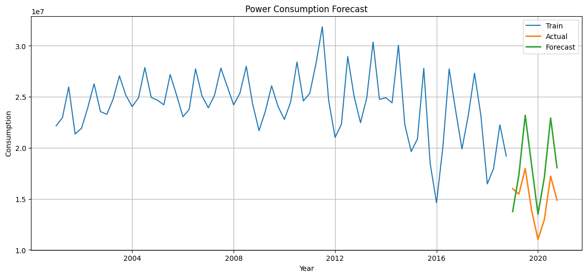

# Power Consumption Forecasting

Problem Statement: Accurate forecasting of power consumption is essential for energy providers to manage grid reliability, optimize resource allocation, and prevent power outages or over-generation. Energy demand fluctuates based on seasonal trends, economic growth, and climatic variations.

Solution: The goal of this project is to model quarterly electricity consumption using historical data and predict future demand over an 8-quarter horizon to aid strategic planning and operational efficiency.



## Tech Stack
- Data Science: NumPy, Pandas, Matplotlib, Seaborn, Scikit-Learn
- Time Series Modeling: statsmodels (ExponentialSmoothing, adfuller, seasonal_decompose)

## Setup Installation
```
pip install numpy pandas matplotlib seaborn statsmodels scikit-learn jupyter
git clone https://github.com/ujjwalkumar14b/Power_Consumption_Forecasting.git
cd Power_Consumption_Forecasting
```

## Author
Ujjwal Kumar
GitHub: [https://github.com/ujjwalkumar14b](https://github.com/ujjwalkumar14b)
